<p align="center">
  <a href="docs/media/guard-demo.mp4">
    
  </a>
</p>
<p align="center"><sub>▶ Kliknij, aby obejrzeć film w pełnej jakości (MP4, 46 s)</sub></p>

<p align="center">
  <picture>
    <source media="(prefers-color-scheme: dark)" srcset="docs/assets/brand/guard-logo-white.svg">
    
  </picture>
</p>

<p align="center"><b>Czyste dane reklamowe. Zaufane raporty.</b></p>

<p align="center">
  <a href="https://github.com/DamianHoffman/guard/actions/workflows/ci.yml"></a>
  
  
  
  
</p>

---

## Co to jest? Wersja na 30 sekund

Sieci reklamowe codziennie przysyłają pliki z wynikami reklam. Każda **w innym formacie** i **z błędami**.
GUARD **sprawdza te pliki, ładuje dobre dane do bazy i pilnuje, żeby nic się nie zgubiło**, a raporty dla biznesu były wiarygodne.

> To **projekt portfolio** na danych syntetycznych. Pokazuje codzienną pracę juniorskiego DevOpsa:
> baza danych, serwer Linux, automatyzacja, kopie zapasowe, ochrona danych osobowych i obsługa użytkowników biznesowych.

<p align="center">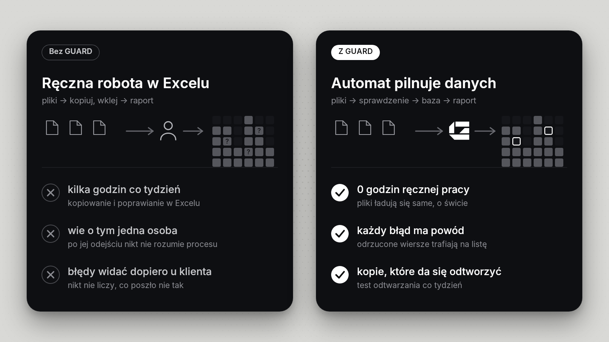</p>

## Jak to działa

<p align="center">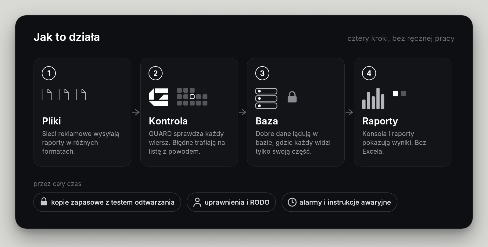</p>

## Zobacz w akcji

<table>
  <tr>
    <td width="50%">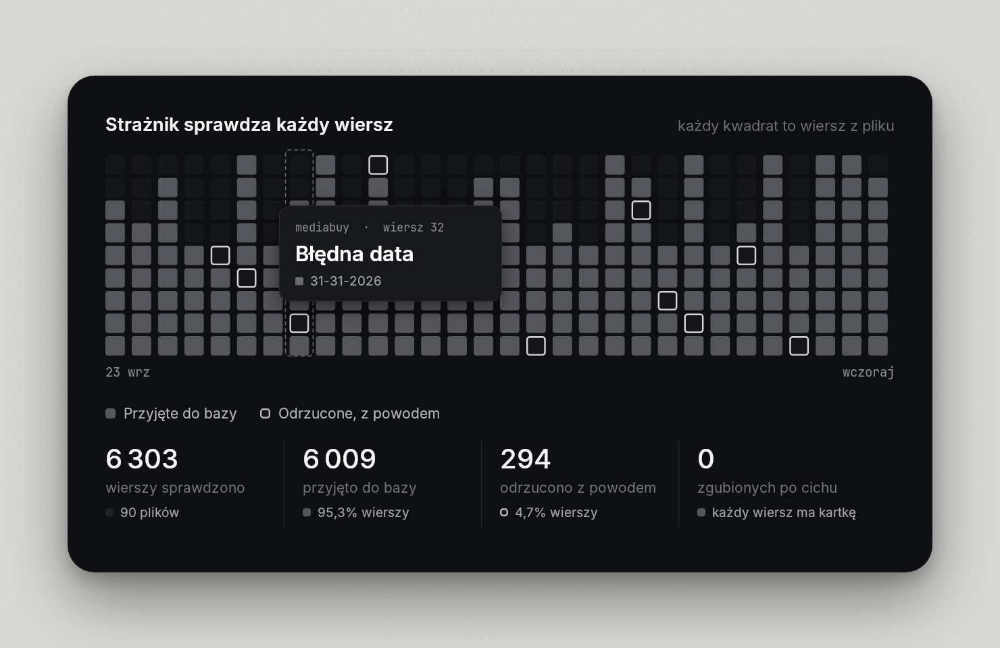<br><b>Każdy wiersz sprawdzony.</b> Błędne trafiają na listę, razem z powodem.</td>
    <td width="50%">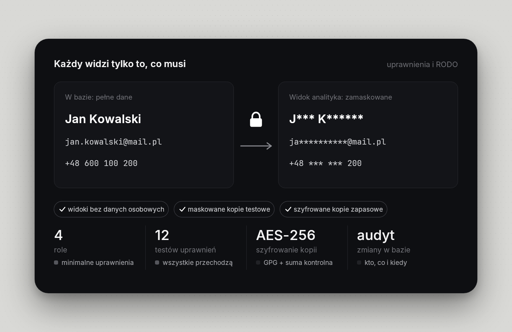<br><b>Dane osobowe pod kontrolą.</b> Analityk widzi tylko zamaskowaną wersję.</td>
  </tr>
  <tr>
    <td width="50%">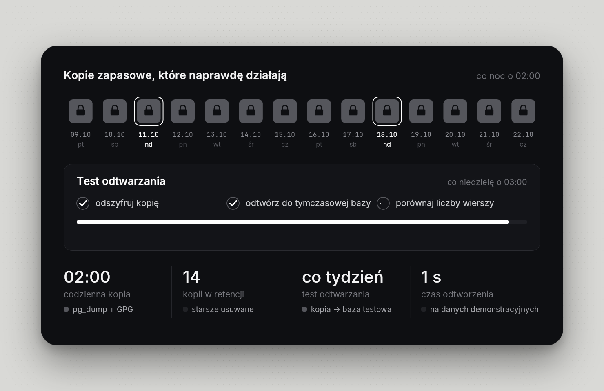<br><b>Kopie, które da się odtworzyć.</b> Co tydzień automatyczny test.</td>
    <td width="50%">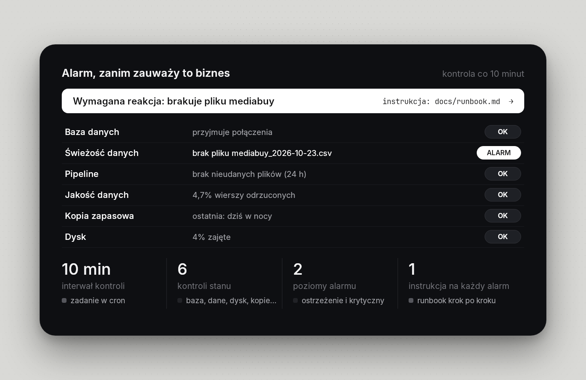<br><b>Alarm, zanim zauważy biznes.</b> Brak pliku od sieci reklamowej? Wiadomo od razu.</td>
  </tr>
</table>

## Konsola dla biznesu

Prosta strona **tylko do odczytu**. Nikt nie może z niej niczego zepsuć ani zobaczyć danych osobowych.

<p align="center">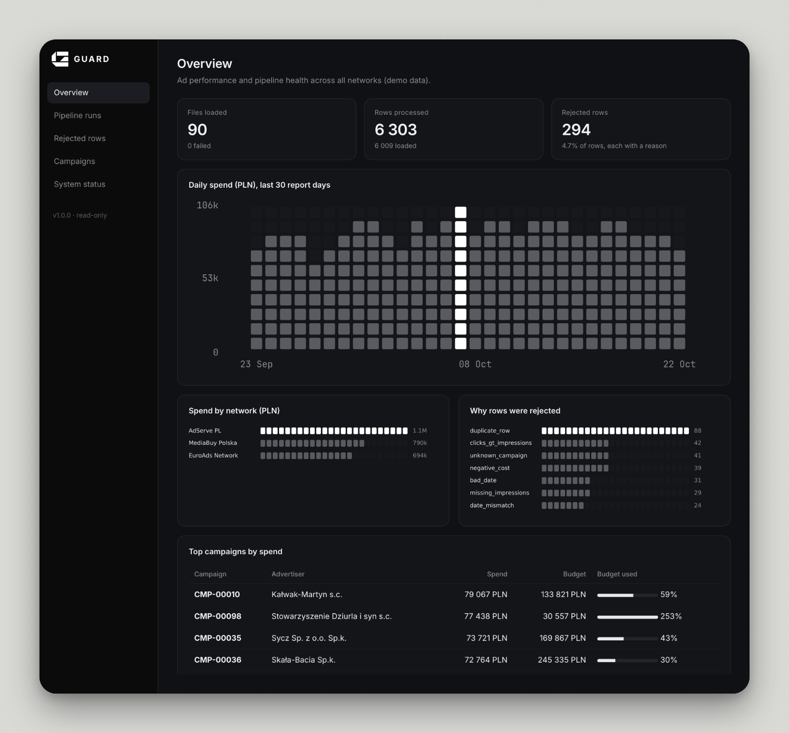</p>

<table>
  <tr>
    <td width="50%">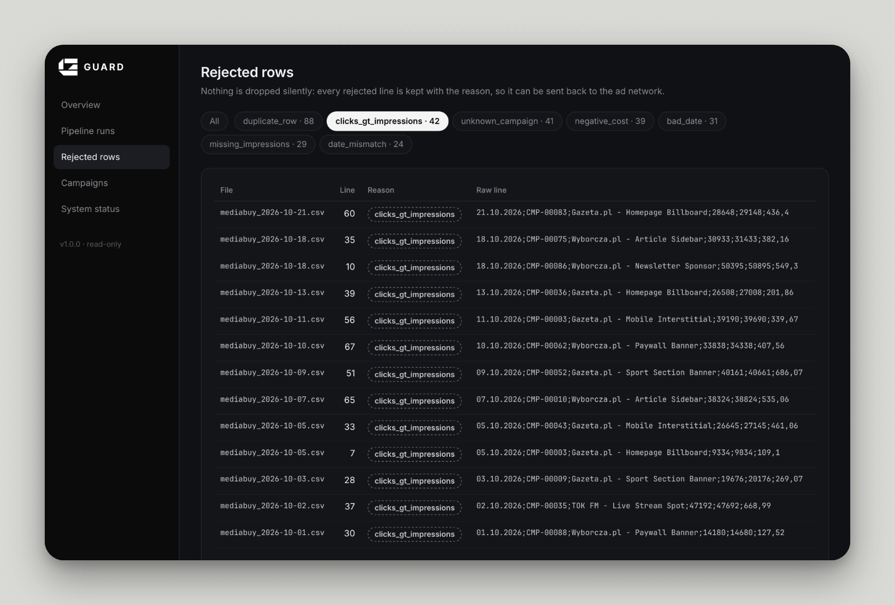<br><sub>Odrzucone wiersze, razem z powodem</sub></td>
    <td width="50%">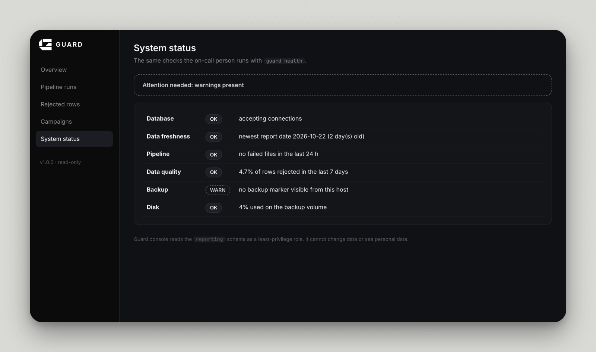<br><sub>Stan systemu: to samo, co sprawdza dyżurny</sub></td>
  </tr>
</table>

## Jeden dzień z GUARD

<p align="center">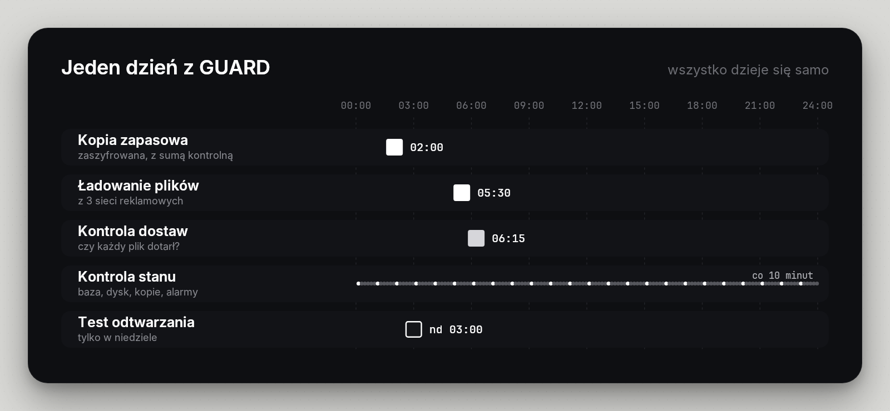</p>

## Dla kogo?

<p align="center">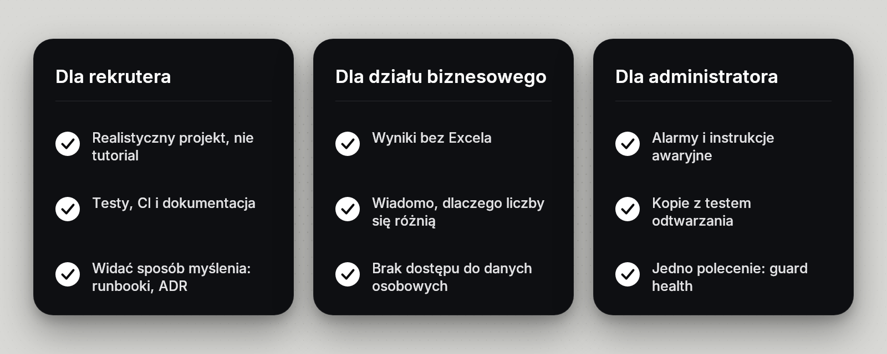</p>

## Liczby z przebiegu demo

| | |
|---|---|
| Pliki załadowane | **90** (3 sieci reklamowe, 30 dni) |
| Wiersze sprawdzone | **6 303** |
| Przyjęte do bazy | **6 009** |
| Odrzucone, każdy z powodem | **294** (4,7%) |
| Czas ładowania wszystkiego | **około 0,7 s** |
| Kopia zapasowa + test odtwarzania | **zaszyfrowana, odtworzona w około 1 s** (małe dane demo) |
| Testy automatyczne | **31** (parsowanie, konsola, cały proces ETL) + **12** testów uprawnień |

Dane są generowane względem bieżącej daty, więc przy własnym uruchomieniu liczby będą trochę inne.

## Uruchom u siebie

Potrzebujesz: Python 3.10+, narzędzia PostgreSQL (`psql`, `pg_dump`), `gpg` i Docker (do pełnego zestawu).

```bash
git clone https://github.com/DamianHoffman/guard.git && cd guard
make setup && nano .env     # instalacja polecenia `guard` i ustawienie haseł (ZMIEŃ wszystkie)
make up                     # PostgreSQL, konsola, Grafana, Prometheus
make demo                   # dane demonstracyjne: 30 dni plików, od razu załadowane
make check                  # lint + testy + testy uprawnień
```

Konsola: <http://localhost:8080> · Grafana: <http://localhost:3000> (tylko na Twoim komputerze).
Bez Dockera? Użyj PostgreSQL zainstalowanego na Ubuntu: opis w [`docs/runbook.md`](docs/runbook.md).

| Polecenie | Po co |
|---|---|
| `guard load` | wczytuje pliki z `data/inbox`: sprawdza, przelicza waluty, zapisuje |
| `guard check` | czy każda sieć dostarczyła dzisiejszy plik? |
| `guard health` | kontrola stanu: baza, dysk, kopie, zawieszone zadania |
| `guard backup` / `restore-test` | zaszyfrowana kopia i test jej odtworzenia |
| `guard mask-copy` | kopia bazy z zamaskowanymi danymi osobowymi (dla programistów) |
| `guard console` | uruchamia konsolę webową |
| `guard demo-data …` | generuje dane testowe, także z celowymi awariami do ćwiczeń |

## Architektura

<p align="center">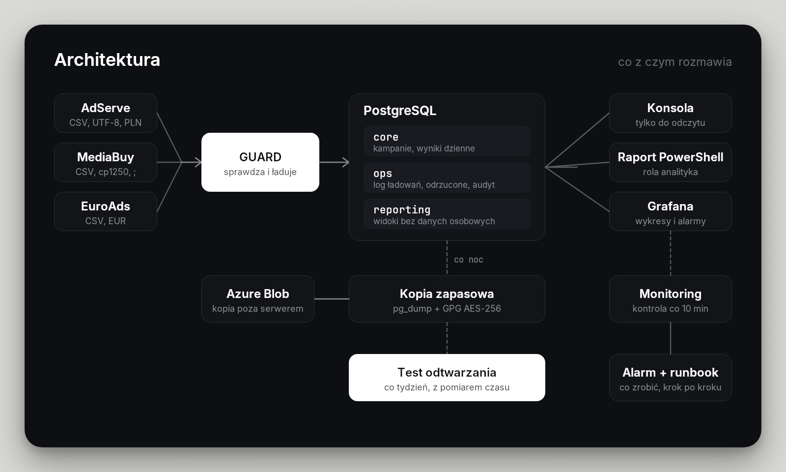</p>

Szczegóły: [`docs/architecture.md`](docs/architecture.md) · decyzje projektowe: [`docs/adr/`](docs/adr/README.md) · cele jakości usługi: [`docs/service-levels.md`](docs/service-levels.md)

## Technologie

<p align="center">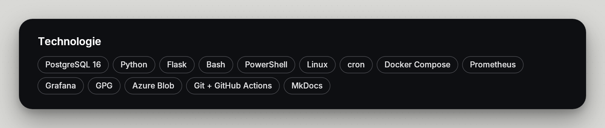</p>

## Co jest sprawdzone, a co nie

| Element | Stan |
|---|---|
| Baza, uprawnienia, audyt, widoki | Sprawdzone w całości (PostgreSQL 16) |
| ETL, kontrola dostaw, awarie na próbę, polecenie `guard` | Sprawdzone: 8 testów całego procesu na tymczasowej bazie oraz przebieg demo |
| Kopie zapasowe, test odtwarzania, kontrola stanu, maskowanie | Sprawdzone w całości |
| Konsola webowa | Sprawdzona: testy stron, uruchomienie samymi zmiennymi środowiskowymi (jak w kontenerze) |
| Skrypty PowerShell | Sprawdzone w PowerShell 7.4 na Linuksie. Windows PowerShell 5.1 i Windows Server: nietestowane |
| Docker Compose, Grafana, Prometheus | Plik zwalidowany (`docker compose config`, hadolint, `promtool`). Kontenerów nie uruchamiałem |
| GitHub Actions | Workflowy sprawdzone narzędziem `actionlint`. Pierwsze uruchomienie na GitHubie jeszcze przed nami |
| Azure, Pentaho | Opisane w `docs/`, nieuruchomione |

Znane ograniczenia: jeden serwer bez replikacji i odtwarzania do punktu w czasie, alarmy bez wysyłki e-mail/czat, małe dane demo.
Plan rozwoju: [`ROADMAP.md`](ROADMAP.md).

## Dokumentacja

Dokumentacja techniczna jest po angielsku (jak w większości zespołów IT):
[runbook](docs/runbook.md) · [ochrona danych / RODO](docs/data-protection.md) · [audyt „odziedziczonego” systemu](docs/legacy-audit.md) ·
[usprawnienie procesu: przed i po](docs/process-improvement.md) · [przykład zgłoszenia od użytkownika](docs/user-support-ticket.md) ·
[ćwiczenia awaryjne](docs/incidents/drills.md) · [jednostronicowe podsumowanie (PDF)](docs/guard-project-brief.pdf)

## O projekcie

Logo, film i wszystkie grafiki w tym repozytorium powstały w kodzie (Python + Skia), źródła: [`tools/video`](tools/video).
Kod: licencja [MIT](LICENSE) · [CONTRIBUTING](CONTRIBUTING.md) · [SECURITY](SECURITY.md) · [CHANGELOG](CHANGELOG.md) ·
[English README](README.en.md)
