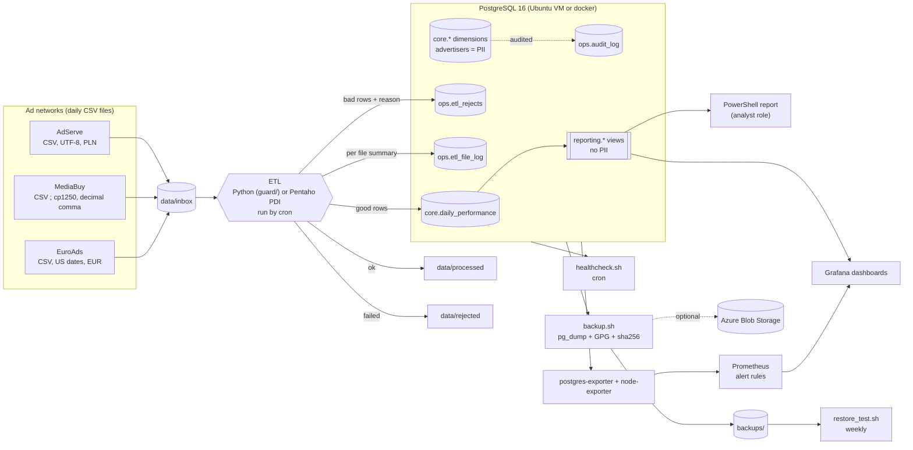

# Architecture

## Components

| Component | Where | Purpose |
|---|---|---|
| PostgreSQL 16 | `docker-compose.yml` or native on Ubuntu | Relational database; schemas `core`, `ops`, `reporting` |
| ETL | `guard/`, `scripts/run_etl.sh` (Pentaho equivalent: `docs/pentaho-guide.md`) | Validates and loads daily files, never loads the same file twice |
| Roles | `db/init/05_roles.sh` | `guard_etl`, `guard_analyst`, `guard_backup`, `guard_monitor`: least privilege |
| Audit | `db/init/03_audit.sql` | Trigger-based audit trail for dimension tables |
| Backups | `scripts/backup.sh`, `restore_test.sh`, `azure_upload_backup.sh` | Encrypted, checksummed, restore-tested, optionally off-site |
| Monitoring | `scripts/healthcheck.sh`, `monitoring/` | Nagios-style check for cron + Prometheus/Grafana |
| Reporting | `powershell/Export-CampaignReport.ps1`, Grafana | Business users read `reporting.*` only |
| Masking | `scripts/mask_nonprod.sql`, `make_nonprod_copy.sh` | Pseudonymised copy for developers/testers |

## Key design decisions (and why)

1. **Row-level rejects instead of failing the whole file.** One bad row from an ad network should not block 500 good rows, but it must never disappear silently: every reject has a reason and the raw line.
2. **File-level failures are loud.** Schema drift or an empty file means the file cannot be trusted, so it is quarantined and alerts fire.
3. **Idempotent loads** (file hash + upsert on the natural key). Re-running after a crash is safe, which is what you want at 3 a.m.
4. **One transaction per file.** After a crash a file is either fully loaded or not at all.
5. **Least privilege.** The ETL cannot read personal data; analysts only see views; the backup role is read-only.
6. **Backups are encrypted and tested.** Encryption because backups contain personal data; tests because untested backups are hope, not a strategy.
7. **Config over code for networks.** A new ad network is one config entry plus one DB row.
